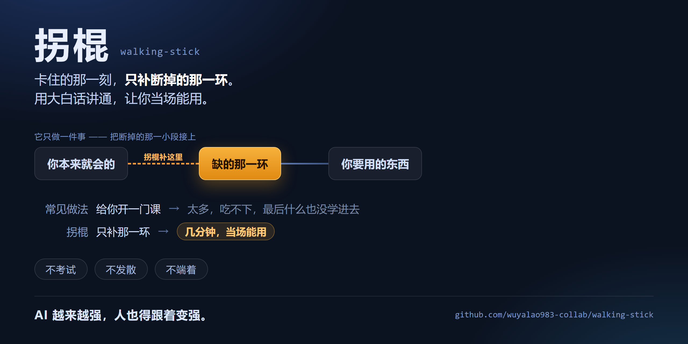

# walking-stick · 拐棍



> **AI 顺手把你带强，而不是替你变强。**
> 在被卡住的那一刻，只补断掉的那一环，用大白话讲通，让你当场能用。

[](LICENSE)
[](https://github.com/anthropics/skills)
[](#贡献)

---

## 这是什么

一个 Skill（技能包）。装进支持 Agent Skills 的 AI 即可使用。

它只解决一件事：**用 AI 干活 / 学习时撞上自己不懂的东西 —— 它不给你开课，只把断掉的那一小段知识链接上，让你跨过去继续干。**

## 为什么做这个（用意）

我做了个观察：**AI 越来越强，可人没跟着变强。**

一个初中生、一个中专毕业的打工人，拿 AI 解决问题时，总会撞上超出自己知识范围的东西。市面上的做法是——给他生成一门课。太多了，他吃不消，最后什么也没学进去。

所以我想反过来：**别给人开课，只把卡住他的那一环补上。**

- 每次只花几分钟；
- 每次都能立刻用上；
- 攒着攒着，他对真实世界的认知就慢慢打开了 —— 跨行业的知识自己长出来，信息不再被关在门外。

**AI 解决问题的能力变强了，人也得跟着变强。**
这个 skill 就是为了这件事：**让 AI 顺手把人带强，而不是替人变强。**

## 为什么叫「拐棍」

不是扶手——扶手得先有楼梯，环境得配合。是**拐棍**：**你走哪条路，它都跟着撑你。**

一根拐棍不替你走路，也不替你决定去哪。它只做一件事：**在你走不稳的那一段，给你一个支点。**

路还是你自己走，只是没那么容易摔了。

## 跟别的"AI 学习工具"有什么不同

| | 常见做法 | walking-stick |
|---|---|---|
| 什么时候给 | 你**主动**说"我要学 X" | 你**被卡住的那一刻**，自动给 |
| 给多少 | 一门课 / 一个主题 | **只给跨过这道坎的最低配** |
| 给完 | 出题测验 | **讲完就收，不考你** |
| 语言 | 术语 | **大白话（强制）** |

## 三条铁律

1. **绝不考试** —— 不出题、不测验。
2. **绝不发散** —— 用不上的，一律不碰。
3. **绝不端着** —— 讲知识点必须用大白话；初中生看不懂，就算失败。

## 它干活长什么样（示意）

**你随口说：**

> 我嘴唇有点白，是咋回事？

**它不会甩你一句"去医院看看吧"，也不会给你上一堂血液学。它只把断掉的那一环接上：**

> 嘴唇的颜色，是靠血里的氧撑着的。血氧不够，或者血里运氧的那个"铁"不够，嘴唇就会发白。
> 所以这事儿分两种：一种是一时的（冷着了、累着了、没睡好），一种是身体在提示你该查一查。
> ——我不是医生，不能替你判断。想弄清楚，去医院挂**血液科**，跟医生说一句：
> 「唇色发白，想做个**血常规 + 铁蛋白**。」
>
> **你缺的那一环是：唇色 ↔ 血氧 / 铁，补上就能用了。**

从头到尾没有"散列函数""负载因子"这种词，也没有课后练习。**讲完就收。**

## 装到哪些 AI 上

标准 **Agent Skills** 技能包，凡是认这套规范的 AI 都能用 —— 放进它的 skills 目录就行：

| 用在哪 | 放哪 |
|---|---|
| Claude Code | `~/.claude/skills/walking-stick/` |
| WorkBuddy / CodeBuddy | `~/.workbuddy/skills/walking-stick/` |
| 只在某个项目里用 | `<项目>/.claude/skills/walking-stick/` |
| 其他支持 Agent Skills 的 AI | 它自己的 skills 目录（以它的文档为准） |

> **唯一的硬要求**：文件夹名必须叫 `walking-stick`，要和 `SKILL.md` 里的 `name` 对上。

## 安装

```bash
git clone https://github.com/wuyalao983-collab/walking-stick.git ~/.claude/skills/walking-stick
```

装完**开一个新对话**才生效（AI 读技能清单是每次开新对话读一次）。

## 怎么用

**自动**：直接抛问题。不管你说"我不懂"，还是直接把现象描述出来，它都会上。

```
我嘴唇有点白
这个 flex: 1 是啥意思
这行代码报错：Cannot read property 'map' of undefined
老板说要做个"用户画像"，这是啥
```

**手动**：说「**撑我一把**」，或敲 `/walking-stick`。

## 它长什么样

每次讲完，结尾固定一句：

> **你缺的那一环是：____，补上就能用了。**

看到这句，就是它在跑。

## 存储

默认存本地独立库：`<工作目录>/walking-stick/`（一个知识点一个 md）。
**不会**默认写进你的 Obsidian / 第二大脑。想连，它会问你一次。

## 目录

```
walking-stick/
├── SKILL.md                      # 主文件
├── README.md
├── LICENSE
├── assets/
│   └── hero.png                  # 头图
└── references/
    ├── example.md                # 完整走一遍（概念类）
    ├── chase-chain.md            # 追链方法 + 三类实例
    └── trigger-tests.md          # 触发测试集（10 正 + 10 反）
```

## 贡献

发现漏触发、误触发，或者讲得不够大白话 —— 都欢迎提 Issue / PR。
`references/trigger-tests.md` 里有现成的 20 句测试集，改 `description` 之后拿它过一遍。

## License

MIT

---

# English

> **AI makes you stronger as a side effect — instead of getting stronger for you.**
> The moment you're stuck, it patches only the missing link — in plain language, so you can move on.

## What it is

A Skill for AI agents. It solves exactly one thing: when you hit something you don't understand while using AI, it **doesn't give you a course** — it patches the single broken link in your knowledge chain so you can keep going.

## Why the name

Not a handrail — a handrail needs a staircase to exist. A **walking stick** goes wherever you go.

It doesn't walk for you, and it doesn't pick your road. It does one thing: **it gives you a point of support exactly where you'd otherwise stumble.**

## The point

**AI keeps getting stronger. People should get stronger too.**

When a student — or a worker with no formal training — uses AI to solve something, they keep hitting things outside their own knowledge. The usual fix is to generate them a whole course. It's too much. They don't finish it, and they learn nothing.

So this does the opposite: **don't hand them a course — patch the one link that's blocking them.**

## Three rules

1. **Never quiz you.**
2. **Never sprawl** — anything not needed for *this* blocker gets dropped.
3. **Never talk in jargon** — explanations use the plainest words; if a middle-schooler can't follow, it failed.

## Signature

Every answer ends with a fixed line (in Chinese): *"你缺的那一环是：____，补上就能用了。"* — that's how you know it's running.

## Trigger

- **Automatic**: any message containing a concept / term / symptom / error / number you probably don't get — whether you say "I don't understand" or just describe the problem.
- **Manual**: say "撑我一把" or run `/walking-stick`.

## Install

```bash
git clone https://github.com/wuyalao983-collab/walking-stick.git ~/.claude/skills/walking-stick
```

Works anywhere Agent Skills are supported — just drop the folder into that agent's skills directory. The folder name must stay `walking-stick` so it matches `name` in `SKILL.md`.

Open a **new conversation** after installing — skill lists are read once per conversation.

## Storage

By default each knowledge chain is saved locally as its own markdown file under `<cwd>/walking-stick/`. It will **not** write into your Obsidian vault unless you say yes.

## License

MIT
